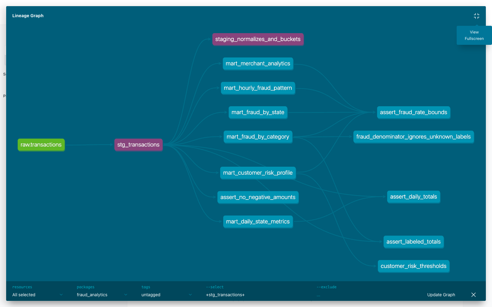

# ДЗ4 — dbt

Продолжение ДЗ2: `homework.transactions` → `stg_transactions` → 6 витрин в базе `analytics`.
В задании исходная база называется `transactions_db`, но здесь оставил имя из ДЗ2.

## Запуск

Сначала поднять ClickHouse и загрузить CSV по инструкции в [основном README](../README.md).
Повторно отправлять уже загруженные данные в Kafka не нужно.

Из корня репозитория:

```bash
docker compose up -d clickhouse
cd dbt
python3 -m venv .venv
source .venv/bin/activate
pip install -r requirements.txt
make deps
make build
make lint
make docs
make serve
```

Docs будут на http://localhost:8082. Подключение к ClickHouse — в `profiles.yml`.
По умолчанию localhost:8123, student/student; можно задать `CLICKHOUSE_HOST`,
`CLICKHOUSE_USER`, `CLICKHOUSE_PASSWORD`.

Версии: dbt-core 1.10.23, dbt-clickhouse 1.9.8, ClickHouse 25.3.3.42.

## Что получилось

- `mart_daily_state_metrics`: число и сумма покупок, средний чек, точный P95, доля крупных покупок по дате и штату.
- `mart_fraud_by_category`: фрод по категориям.
- `mart_fraud_by_state`: фрод, клиенты и мерчанты по штатам.
- `mart_customer_risk_profile`: история и уровень риска клиента.
- `mart_hourly_fraud_pattern`: фрод по дню недели и часу UTC.
- `mart_merchant_analytics`: оборот и флаг подозрительного мерчанта.

В `test.csv` нет target. Поэтому fraud_rate считается только среди размеченных строк,
в процентах; при отсутствии меток получается NULL. Оборот считается по всем строкам.
Уникальный ID транзакции — имя файла и номер строки. ID клиента приблизительный:
хеш имени, фамилии, улицы и индекса, так как настоящего customer_id нет.

Макрос `amount_bucket` разбивает суммы: SMALL <100, MEDIUM <500, LARGE от500.
Риск клиента: HIGH от5% фрода, MEDIUM от1%, LOW ниже1%, UNKNOWN без меток.
Мерчант подозрительный при >=100 размеченных транзакций и fraud_rate >=1%.
Это простые правила для анализа истории, а не модель для предсказания.

Используются `dbt_utils` (ключ клиента и уникальность составных ключей),
`dbt_date` (день недели) и `dbt_expectations` (непустой staging).
Для `day_of_week` добавлена реализация под ClickHouse.

## Проверки

```bash
make test
make lint
cd ..
pre-commit install
pre-commit run --all-files
```

34 data tests: not_null, unique, accepted_values, уникальность ключей витрин,
неотрицательные суммы, границы fraud_rate, сверка количества строк и сумм.
3 unit tests: очистка и границы amount_bucket, знаменатель fraud_rate с NULL,
границы риска клиента и UNKNOWN.

Проверено на 1 048 575 строках: 786 431 с меткой и 262 144 без неё.
Все 37 тестов прошли. Логи и примеры результатов — в [results](results).
SQLFluff настроен с dbt templater. Для параметрического `quantileExact(0.95)(amount)`
есть локальный noqa: SQLFluff 3.4.2 не разбирает этот синтаксис ClickHouse.


